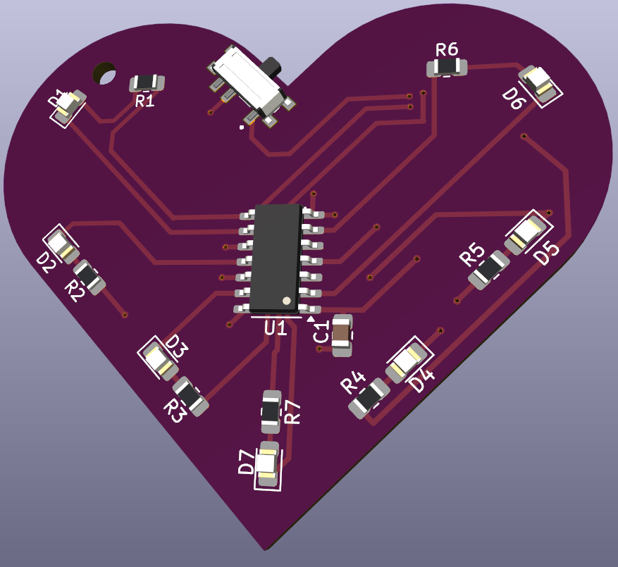
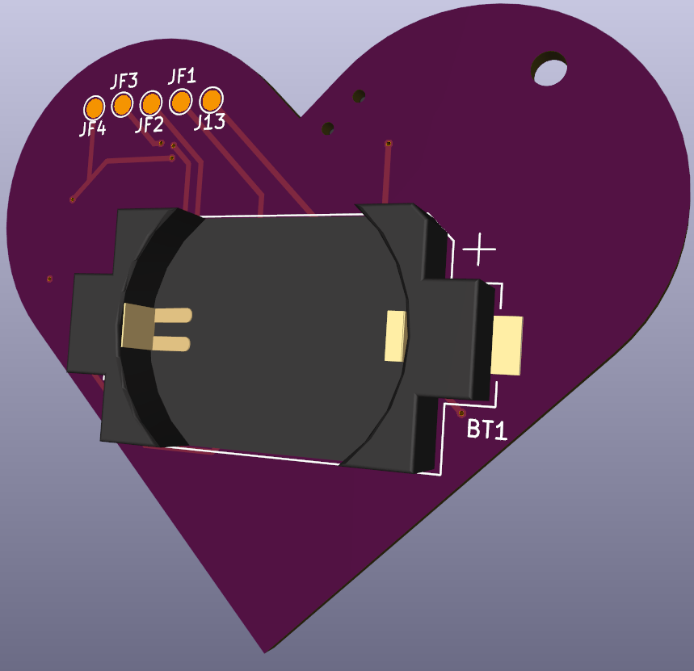

# Heart-shape-key-charm
This project features a key charm to display simple animations using 7 SMD LEDs. The key charm is meant to be used without a case and includes a hole throughout the PCB to connect it to a keychain.

   

        
       <em> Front view </em>
   

        
       <em> Back view </em>
   

## Specification:
Microcontroller: **Attiny 84a**  
Powersource: **CR 2032**  
LEDs: **Kingsbright red (2mA)**  
Power Switch: **Slide Switch (EG1215AA)** 

## Documentation:
Software: **firmware/README.md**  
Hardware: **hardware/README.md**  

## Assembly / Soldering:
The keycharm was designed to hold most of its SMD components on the front side of the pcb. For this reason the keycharm can easily be soldered at home. The fastest way is using a stencil (order it with pcb!) and a heatplate.
### Setup:
#### Heatplate
The **UYUE 946C** heatplate was used for this setup. It was heat up to **230 °C** and the PCBs was "baked" for approximately **2 min and 30 seconds**.
#### Solderpaste
KEK Solder Paste with the following specification was used:  
Sn-96.5 Ag-3.0 Cu-0.5 (microns:20-38) melting point at approximately 217 °C

## Flashing

### Connection
Pins to program the Attiny 84a are exposed using pads on the backside of the PCB.
Only use 3 V (or 3.3 V) for powering the key charm!
| PCB Pad  | Attiny 84a Pin | ISP |
| ------------- | ------------- | ---|
| JF3   | PA4  | SCK   |
| JF4   | PA5  | MISO  |
| JF1   | PA6  | MOSI  |
| JF2   | PB3  | RESET |
| JVcc1 | Vcc  | Vcc   |
| JGND1 | GND  | GND   |

Those Pads can either be soldered to wires for a reliable connection. If you only intend to flash a working version of the firmware once it is recommended to just use a 1x6 pin header and physically press it on the pads.

### Programmer
The key charm is intended to be programmed by an Arduino ISP programmer (e.g. Arduino Uno). Generally any boardmanager can be used that supports the Attiny84a examples for boardmanagers are the following:
- https://github.com/SpenceKonde/ATTinyCore
- https://github.com/damellis/attiny

### Attiny Setup
- Set clock to: **1 MHz Internal**
- Set Processor to: **Attiny 84**

=> Typical user error: make sure you upload the code using the programmer.