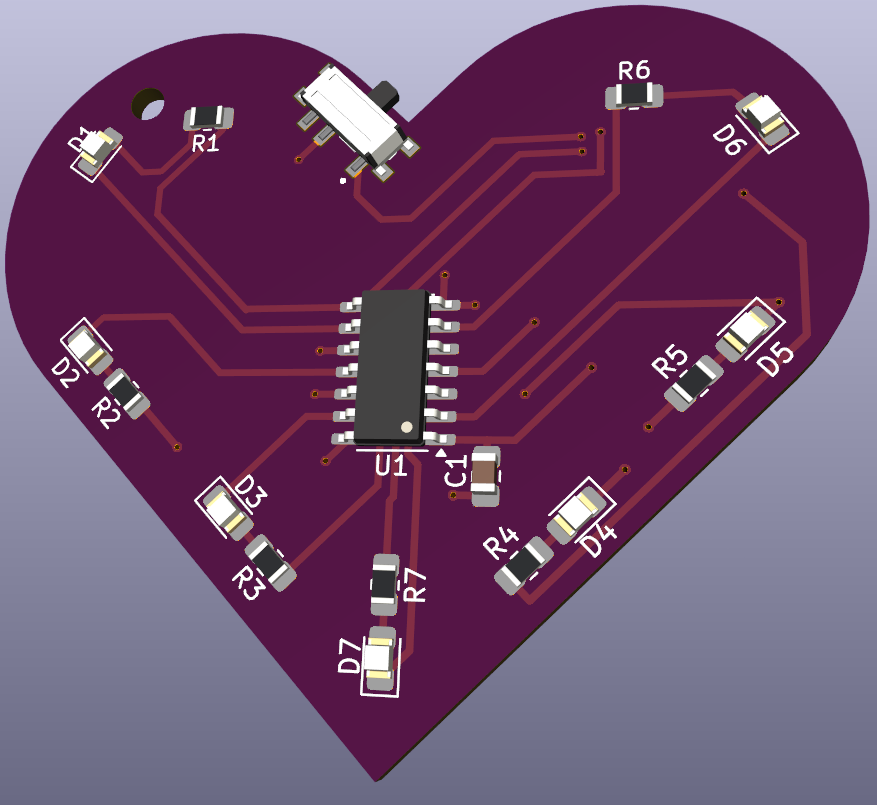
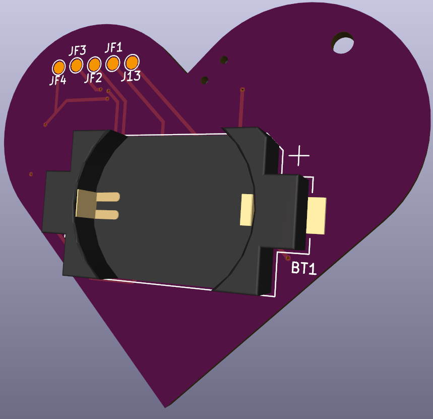

# Heart-shape-key-charm
This project features a key charm to display simple animations using 7 SMD LEDs. The key charm is meant to be used without a case and includes a hole thoughout the PCB to connect it to a keychain.

    

         
        <em> Front view </em>
    

         
        <em> Back view </em>
    

## Specification:
Microcontroller: **Attiny 84a**  
Powersource: **CR 2032**  
LEDs: **Kingsbright red (2mA)**  
Power Switch: **Slide Switch (EG1215AA)** 

## Documentation:
Software: **firmware/README.md**  
Hardware: **hardware/README.md**  