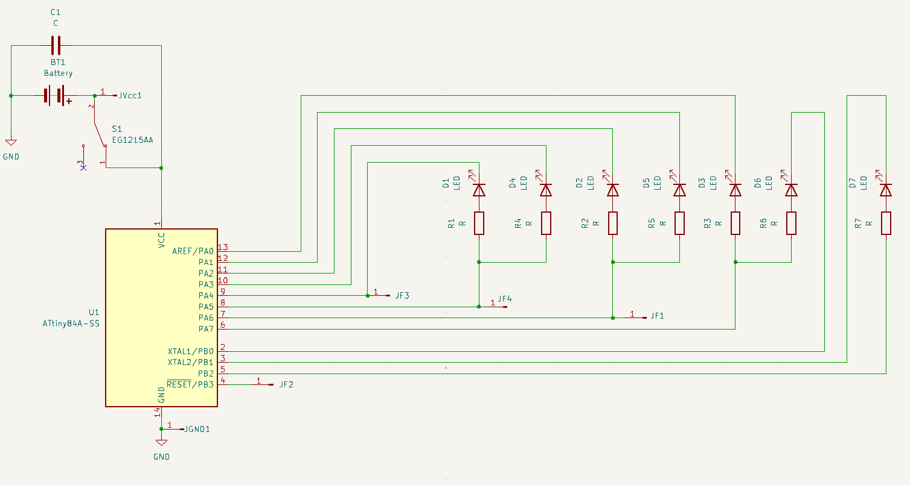

# Hardware
## Components (for one key charm)
- PCB: **FR-4(two layers)** [x1]
- Microcontroller: **Attiny 84a-SS** [x1]
- LEDs: **Kingsbright red (2mA)** [x7] 
- Resistor: **680 ohm (0805)** [x7] 
- Powersource: **CR2032** [x1]
- Coin Cell Holder (CR 2032): **Keystone 1060** [x1]
- Capacitor: **22uF;10V;X5R;(0805)** [x1]
- Slide Switch: **EG1215AA E-Switch** [x1]

## Schematic

     
    <em> Schematic </em>

## Driving LEDs
No external LED driver or amplifier was used as the low power LEDs do not require a higher output power than what the Attiny 84a already provides.
### PWM control
The Attiny 84a features 4 PWM pins. In order to control all 7 LEDs, 3 PWM pins are shared by a pair of LEDs: D1 and D4, D2 and D5 as well as D3 and D6. LED D7 does not share a PWM pin and will be driven individually. LEDs that share a PWM pin are located across each other. This allows a circular animation driving 3 neighbouring LEDs with different PWM values at the same time, as every LED and its direct 2 neighbouring LEDs are driven by individual PWM pins.
### Connection to GND or Vcc
Instead of connecting each LED to Vcc or GND statically and controlling the LEDs solely by PWM additional digital pins are used to either turn a single LED on or off. Each LED is connected to one digital pin either driving the output LOW or HIGH. For example: LED D1 and LED D4 share the same PWM signal. If these two LEDs would be statically connected to Vcc or GND they would light up identically. The additional control over the digital pins allows for LED D4 to light up even when LED D1 is turned off.

## Programming Attiny 84a
Pins to program the Attiny 84a are exposed using pads on the backside of the PCB. 
Only use 3 V (or 3.3 V) for powering the key charm! 
| PCB Pad  | Attiny 84a Pin | ISP |
| ------------- | ------------- | ---|
| JF3   | PA4  | SCK   |
| JF4   | PA5  | MISO  |
| JF1   | PA6  | MOSI  |
| JF2   | PB3  | RESET |
| JVcc1 | Vcc  | Vcc   |
| JGND1 | GND  | GND   |